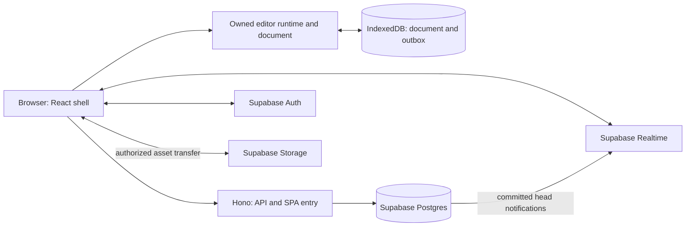

# Hydraw: product and engineering plan

Planning baseline: 20 October 2026. Status: local drawing, labels, visual export and clipboard workflow implemented; hosted deployment and later product stages remain planned. See [the milestone log](docs/PROGRESS.md) for implemented scope and [ADR 0001](docs/adr/0001-owned-local-editor.md) for current engineering decisions. The repository was empty when this plan was written.

## 1. Product direction

**Hydraw is a fast visual workspace for turning rough ideas into clear diagrams, technical explanations, and lightweight designs.** Start drawing immediately, add structure as needed, and share without rebuilding the work in another application.

Initial audience: developers, technical founders, and small product teams. This is a planning assumption, chosen because architecture diagrams, flows, wireframes, and collaborative explanations overlap strongly across the reference products. Broader design and workshop use can follow.

The ambition is one coherent editor with exceptional interaction quality. Feature count alone will not make it better than the established products.

| Inspiration | What Hydraw should borrow                              | First concrete expression                                 |
| ----------- | ------------------------------------------------------ | --------------------------------------------------------- |
| Excalidraw  | Immediate drawing, readable defaults, sketch aesthetic | Open a board and draw without an account                  |
| draw.io     | Structured diagrams and reliable connections           | Bound connectors, labels, ports, alignment                |
| Eraser      | Technical explanation and text-driven workflows        | Architecture templates; later, diagram source blocks      |
| Miro        | Shared spatial thinking                                | Notes, frames, presence, comments, presentation           |
| Figma       | Precise manipulation and reusable styles               | Excellent snapping, properties, layers, reusable elements |

The signature workflow: sketch an architecture, connect its components, clean up its layout, add explanatory notes, then share or present the same board. Sketch and clean rendering are properties of the same objects. Switching appearance preserves identity, connections, and comments.

### Product principles

- **Start in the canvas.** A guest opens a local board immediately; sign-in appears when cloud saving or collaboration becomes useful.
- **Every gesture feels deliberate.** Pointer movement draws locally; networking never blocks the gesture.
- **Structure is progressive.** A rectangle can become a named service, a component, or a frame without forcing a new document type.
- **Context beats clutter.** Keep the main toolbar short; reveal relevant controls on selection. Provide both keyboard and visible menu access.
- **Trust is part of UX.** Distinguish local persistence, pending upload, cloud acknowledgement, and failure.
- **Files remain portable.** Publish a versioned native format and make useful export available early.

### A specific first-use experience

1. Open `/` and receive a usable local canvas. Offer small optional starters: blank, flowchart, architecture, wireframe.
2. Draw a box, type its label directly, drag a connector handle to another box.
3. Use a contextual action to align or tidy the selection. Preview substantial layout changes; commit as one undoable action.
4. Press the command shortcut to search actions, objects, and templates.
5. Export immediately, or sign in to save/share. Preserve the local board until cloud upload and asset upload have succeeded.

Desktop editing comes first. Tablet drawing follows input QA; phones initially support viewing, navigation, and comments. Do not market complete mobile editing until it has been built and tested.

## 2. Scope and sequencing

### Current execution sequence

The local engine and canvas-first workspace are implemented, with verified code cleanup.
The next release should complete one useful architecture-diagram workflow rather
than expand the entire tool catalog at once. [The current next-step plan](docs/NEXT.md)
records the completed canvas-first workspace, fit navigation, direct shape tools,
attached labels, SVG/PNG export, clipboard reuse, smart placement, flat grouping,
locking, object ordering, named frames and three editable technical presets.
Connector routing and larger-board interaction quality follow;
a measured local-alpha gate remains. [The workspace UX record](docs/UX_PLAN.md)
specifies the replacement for the previous header/sidebar shell.
Cloud saving and collaboration follow their own correctness prototype; they do not
block improving the local drawing experience.

### Local alpha: the editor earns trust

- Pan/zoom, selection, multiselection, drag, resize, rotate, duplicate, clipboard, keyboard shortcuts.
- Rectangle, ellipse, diamond, line, arrow, freehand, plain text, sticky note, image, group, frame.
- Bound connectors and labels; straight and elbow routing; predictable behavior when attached objects move or disappear.
- Clean and sketch styles; a small set of good typography, color, and spacing defaults.
- Snap to geometry, align/distribute, lock/hide, basic layers list, zoom to selection.
- Local persistence, crash recovery, gesture-scoped undo/redo, native file import/export, SVG/PNG export.
- A command palette and shortcut reference. A genuinely usable empty state.

### Private beta: cloud and small-team collaboration

- Supabase sign-in, personal workspace, board dashboard, rename, duplicate, trash and restore.
- Cloud save, reconnect, offline outbox, explicit save state, multi-tab correctness.
- Named-user sharing: owner, editor, viewer. Start with account-based invitations that do not require an email-delivery system.
- Two-to-five simultaneous editors, presence/cursors, remote committed edits, comments anchored to shapes.
- Read-only capability links through a separate access path, with expiry/revocation.
- Modest automatic checkpoints and explicit named versions; restoration preserves a recoverable copy.

### Useful v1: the distinctive workflow

- Better architecture and flowchart templates, reusable shape presets, a curated icon library with tracked licenses.
- Selection-based auto-layout, improved connector routing, frames as presentation slides.
- Code/explanation cards, search within a board, better text and styling.
- A limited documented subset of Excalidraw import with a conversion report; preserve the original uploaded file locally for recovery.
- Performance, accessibility, onboarding, and sharing polish based on actual usage.

### Later, when justified

- Diagram source blocks, selected Mermaid import, richer technical notation, team libraries, reusable components.
- Lightweight wireframe components and layout constraints, richer docs next to the canvas.
- Workshop tools, richer comments/mentions, public templates, larger teams.
- Optional AI generation and editing, always previewed, validated, and undoable; requires its own cost budget.

Defer full Figma parity: vector boolean editing, sophisticated auto-layout, component variants, prototyping, dev handoff, and design-system management. Also defer arbitrary plugins, arbitrary HTML embeds, full draw.io/Figma round-trip compatibility, video/media boards, and enterprise administration. Each is a substantial product or subsystem.

## 3. Stack decisions

Keep the requested foundation: **TypeScript, React, Hono, Drizzle, PostgreSQL on Supabase, Docker packaging, and Vite+.**

| Concern              | Proposed choice                                           | Why / boundary                                                         |
| -------------------- | --------------------------------------------------------- | ---------------------------------------------------------------------- |
| Workspace            | pnpm workspaces, managed through `vp`                     | One lockfile and explicit internal dependencies                        |
| Toolchain            | Vite+                                                     | Build, lint, format, test, package tasks through one toolchain         |
| Frontend             | React SPA with explicit route handling                    | Keep application navigation separate from the editor runtime           |
| API                  | Hono, Node runtime in one container                       | Small stateless application with conventional HTTP endpoints           |
| API typing           | Hono RPC types plus owned boundary validators             | Typed internal calls; validate every untrusted boundary                |
| Dashboard data       | Small application request/cache layer                     | Explicit loading, retry and invalidation behavior                      |
| Ephemeral UI         | Owned observable stores with React subscriptions          | Selection, panels, tools; isolated subscriptions                       |
| Shared document      | Owned records, deterministic reducer and command protocol | Explicit revision/conflict semantics and server-authoritative ordering |
| Local durable cache  | Native IndexedDB with owned transaction/outbox layer      | Recover changes independently of cloud connectivity                    |
| Database             | Drizzle + Supabase Postgres                               | Typed relational schema and reviewed SQL migrations                    |
| Identity             | Supabase Auth                                             | Existing OAuth/JWT/session system                                      |
| Realtime             | Supabase private Broadcast + Presence                     | Notifications and ephemeral awareness; persistence is separate         |
| Assets               | Private Supabase Storage                                  | Direct asset transfer avoids proxying files through functions          |
| UI foundation        | Owned React controls and CSS design tokens                | Accessibility is an implementation and verification responsibility     |
| Browser verification | Playwright                                                | Pointer, text, clipboard, offline, multi-client and export checks      |

These are proposed dependency families, not instructions to install floating latest versions. During scaffolding pin compatible toolchain/runtime versions, commit the lockfile, and validate against the pinned container runtime. Native browser APIs should cover simple needs before adding packages.

Vite+ supports workspace tasks and root-level shared configuration, so there is no initial need for Nx or Turborepo. Use root lint/format overrides and package-specific build/test configuration. [Vite+ monorepo guide](https://viteplus.dev/guide/monorepo)

## 4. Decision: build and own the editor system

User direction: Hydraw should own its core systems and has time to develop them properly. Do not embed or depend on Excalidraw, tldraw, another editor SDK, Konva, Rough.js, perfect-freehand, or an external collaboration engine. Reference products inform interaction research; their internals do not define Hydraw's architecture.

Retain the explicitly chosen application stack: React, Hono, Drizzle, PostgreSQL/Supabase, Docker packaging, and Vite+. Browser APIs and development tools remain foundations. Additional production dependencies need a specific justification; no new product subsystem is delegated to a library by default.

### What we own

- Semantic document records, schema validation, migrations and portable file format.
- Geometry, transforms, spatial indexing, snapping, connector binding and routing.
- Tool state machines, pointer/keyboard interaction, selection and manipulation.
- Canvas rendering, deterministic sketch rendering, freehand stroke processing and export.
- Text-editing integration, text layout rules, object navigation and accessibility behavior.
- Transaction/command system, local persistence, history and collaborative undo policy.
- Versioned synchronization protocol, admission, conflict rules, recovery and checkpoints.

### Implementation direction

Start with native Canvas 2D for scene rendering, DOM overlays for text input and accessible controls, and our own geometry shared with SVG export. Use browser text shaping and IME behavior rather than attempting to create a font shaper or input method. Keep the editor runtime independent of React; React presents controls and subscribes to narrow state changes.

Implement clean geometry first. Add deterministic sketch perturbations and pressure-aware freehand strokes as separate algorithms over the same canonical objects. Keep rendering output derived from semantic content; changing rendering must not rewrite user documents.

Build a vertical foundation prototype with labelled bound arrows, multiselection transforms, IME text input, undo, export, and measured performance. Its purpose is to discover and correct our design, not to select a third-party editor. If a gate fails, improve the system or narrow the next milestone while retaining ownership.

Owning code does not automatically produce a good architecture. Require explicit invariants, dependency boundaries, executable correctness checks, documented tradeoffs and performance evidence. Avoid designing every future feature before the first real drawing journey works.

Custom collaboration starts with an authoritative server and a versioned command protocol. Do not make a general-purpose CRDT a prerequisite for drawing. Seamless character-level concurrent text editing and arbitrary offline merge are separate research and correctness milestones; expose conflicts explicitly until those semantics are implemented.

## 5. Runtime architecture and deployment

Use a **modular monolith**, one public application deployment, and managed Supabase capabilities. Keep HTTP handlers thin; separate domain policy, editor logic, and infrastructure.



### React served with Hono

`apps/web` produces the React static build. A multi-stage Dockerfile builds both applications and copies the web assets plus a self-contained Hono bundle into one runtime image. One Node process serves the entire application.

- `/api` and `/api/*` are reserved for backend routing and JSON API errors.
- Other GET/HEAD requests first resolve files from the frontend build; unmatched frontend paths receive React's entry point.
- Hono mounts the frontend directly. There is no separate production frontend service, CDN routing requirement or provider-specific build assembly.
- Local development still uses Vite HMR and an `/api` proxy to Hono; production runs the built application.

The current packaging contract is container-first. Select hosting for that artifact when deployment is needed; earlier Vercel-specific assembly assumptions are superseded. Supabase remains the proposed database/Auth/Storage/Realtime provider. Validate application region and connection limits against the chosen host before cloud integration. [Hono static serving](https://hono.dev/docs/getting-started/nodejs)

## 6. Monorepo structure and boundaries

```text
hydraw/
  apps/
    web/                    React routes, dashboard, editor shell, browser adapters
    server/                 Hono composition, API routes, Node entry point
  packages/
    document/               record schemas, serialization, migrations, operation reducer
    editor/                 commands, tools, geometry, bindings, render adapters
    ui/                     shared accessible controls and design tokens
    contracts/              runtime API schemas and transport DTOs
    db/                     Drizzle schema, SQL migrations, server repositories
  tooling/                  shared config, boundary checks, container verification
  supabase/                 local config, policy/Storage/Realtime SQL support
  tests/
    e2e/                    real browser journeys and multi-client scenarios
    fixtures/               versioned documents, exports, performance scenes
  docs/
    adr/                    decisions with reasons and revisit triggers
  PLAN.md
  package.json
  pnpm-workspace.yaml
  pnpm-lock.yaml
  vite.config.ts
  tsconfig.base.json
```

Create packages as real boundaries become useful. Keep geometry, rendering, and collaboration modules inside `editor` initially; extract a package only when a second consumer or independently testable boundary warrants it. Avoid dozens of empty packages.

Dependency rules:

- `document` is independent of React, Hono, database drivers, and deployment SDKs. It owns its records, validation, deterministic reducers and operation definitions.
- `editor` depends on `document`; its core commands and geometry have no React dependency. React bindings and canvas adapters are explicit submodules.
- `web` imports `editor`, `document`, `ui`, and `contracts`. The Hono RPC route type is a type-only export; no server runtime enters the browser bundle.
- `server` imports `db`, `contracts`, and document validation. It does not import the frontend or renderer.
- `db` is server-only; credentials and connection modules must fail browser import checks.
- Features own their service logic: `boards`, `sharing`, `assets`, `workspaces`, `comments`. Routes call services; services enforce policy and call repositories.
- Export small public package entry points. Enforce dependency direction and prohibit cross-package deep imports in CI.

Use feature folders inside the applications. Share deliberate domain concepts rather than generic `utils`, `helpers`, or a universal repository abstraction.

### Vite+ workflow

Use `vp install`, `vp check`, `vp test`, package-targeted `vp build` / `vp pack`, and workspace task orchestration through `vp run`. Keep `dev`, aggregate `build`, browser tests, and database commands as explicit workspace tasks. Built-in `vp dev` differs from invoking a custom task via `vp run dev`. [Vite+ guide](https://viteplus.dev/guide/) [Task runner](https://viteplus.dev/guide/run)

During setup, define a dependency-aware build graph: document/contracts before consumers when emitted artifacts are required; web and server builds before container packaging. Cache pure builds/checks using declared inputs. Do not cache deployments, migrations, secrets, or environment-dependent integration work. Verify the exact CLI syntax against the pinned release before writing CI.

## 7. Editor and document model

### Three kinds of state

| State                  | Examples                                                         | Storage / ownership                                          |
| ---------------------- | ---------------------------------------------------------------- | ------------------------------------------------------------ |
| Shared durable content | Shapes, text, bindings, frame membership, styles                 | Owned page documents, local cache, cloud operation log       |
| Local interaction      | Selection, camera, hover, active tool, drag preview, open panels | Editor/session stores; optional local preference persistence |
| Ephemeral awareness    | Cursor, presence, active page, transient drag preview            | Realtime with expiry; never part of undo/history             |

Use relational records for workspace and board metadata. Use one independently versioned document per page to bound loading, validation, and collaboration. Board/page order and access live in PostgreSQL, not inside client-editable page content. Start the UI with one page if that reduces scope; retain explicit page IDs in the format.

### Canonical records

- Board: relational identity, workspace, title, permissions and lifecycle.
- Page: relational identity and title/order; content identified by document epoch.
- Shape: stable ID, type, parent/frame ID, ordering key, transform, dimensions, style reference, versioned type-specific properties.
- Connector: its own ID and styling, start/end anchors, optional shape/port bindings, labels and route hints.
- Text: plain-text editing first, explicit font/size/alignment and layout rules; rich text later.
- Asset reference: stable asset ID and dimensions; no embedded binary blobs in shared content.

Represent shapes by ID in owned record maps, with per-field or field-group revisions for conflict detection. Position is one atomic transform value. Text starts as a versioned plain string. Ordering uses stable fractional keys plus an ID tie-breaker. Renormalization is an explicit server-admitted operation, not a rendering side effect.

Record storage is not a substitute for semantic rules. Concurrent edits require explicit preconditions and conflict responses. Independent field edits may compose; same-field edits must not silently overwrite each other. Deleted records reject stale modifications, and orphaned bindings have a documented safe behavior. Do not claim intent-preserving concurrent transforms.

Parent cycles, invalid ports, missing assets, unknown shape versions, extreme dimensions, and non-finite numbers must be rejected or rendered safely. Deleted targets detach or suppress connectors according to one documented rule. Undo must not resurrect an object deleted by another user accidentally. Deletion/tombstone policy needs focused merge tests before collaboration release.

### Command and rendering pipeline

```text
Pointer / keyboard / menu / import
  -> tool state machine
  -> semantic command
  -> document transaction
  -> changed-record subscriptions
  -> geometry and binding invalidation
  -> renderer + contextual controls + local persistence
  -> independent cloud sync queue
```

Commands include `CreateShapes`, `TransformSelection`, `BindConnector`, `SetStyle`, `DeleteSelection`, and `ApplyLayout`. Each user action defines an undo boundary. A continuous drag uses an interaction preview and commits a bounded durable edit, rather than appending a database record for each pointer event. Long drawing/text gestures receive periodic local recovery checkpoints.

Own the history stack and inverse-command construction. Keep remote actions out of the local undo stack. Collaborative undo submits a conditional inverse against current revisions; it must not overwrite another user’s later changes. See the synchronization protocol for conflict handling.

Keep pointer handling and scene updates out of React-wide rerenders. Subscribe contextual controls to selected records; update the renderer from document deltas. Use world coordinates, a consistent transform matrix, a spatial index, viewport culling, dirty-layer rendering, cached geometry, and device-pixel-ratio handling. Move heavy layout/import computation to workers when profiling warrants it.

The shape registry defines validation, defaults, geometry, ports, rendering, export, and migration for built-in shape types. This is an internal extension mechanism initially; arbitrary third-party code is deferred.

Canvas text and the DOM editing overlay must share font metrics, wrapping, baseline, and sizing rules. Prototype CJK/IME, emoji, RTL, pasted text, and font loading early. Accessibility requires keyboard creation/manipulation, visible focus, accessible properties, a navigable object/layers view, and reduced-motion support. A canvas bitmap alone is insufficient.

Use consistent geometry for on-screen rendering and SVG export. Derive PNG from a tested export path. Wait for fonts/assets and warn about substitutions. Cross-origin assets must be fetched through controlled storage paths to avoid tainted canvas exports. Persist roughness seeds so sketch geometry stays stable.

### File format and migration

The `.hydraw` portable format has a format version, board/page metadata, semantic records, and an asset manifest. Prefer a ZIP container with JSON and assets for a complete portable board. Internal cloud synchronization uses versioned semantic operations; neither rendering caches nor raw React state define the public file format.

Validate import sizes and archive expansion limits, migrate through explicit version steps, and report unsupported elements. Keep migration fixtures from each shipped version. Publish JSON schema/documentation when the format stabilizes. Read-only forward compatibility is preferable to silently dropping unknown data.

## 8. Persistence and collaboration protocol

**A delivered realtime message is not a durable save acknowledgement.** Supabase Broadcast has replay for some database-origin messages, but limited retention and replay count make it unsuitable as the canonical document history. [Supabase Broadcast](https://supabase.com/docs/guides/realtime/broadcast)

Own a versioned operation protocol. Hono admits semantic commands, PostgreSQL holds canonical page snapshots plus an ordered operation log, and Supabase Realtime carries committed-head notifications and ephemeral awareness. This is server-authoritative collaboration with optimistic local editing, not a CRDT or a claim of automatic conflict-free merging.

### Operation envelope and conflict semantics

Each submitted command includes page ID, document epoch, protocol version, unique operation ID, client-session ID, base page sequence, expected revisions for affected record fields/groups, and a bounded typed payload. Derive actor identity on the server. Version the command payload and deterministic reducer together.

Initially use explicit conflict detection:

- Commands affecting unrelated records or independent fields may apply despite a stale page sequence when all affected preconditions still hold.
- Treat a transform as one atomic field group. Concurrent edits to the same transform conflict rather than producing a position nobody intended.
- Text starts as a plain string with a revision. Concurrent edits to that string require resolution; do not silently overwrite a paragraph. Character-level OT/CRDT semantics are a later subsystem.
- Parent/order changes validate the affected relationships, not just the moved record. Prevent cycles and apply a deterministic ordering tie-breaker.
- Deleting a record suppresses stale edits to that record. Server-generated binding adjustments are part of the same transaction.
- Commands involving a selection, layout, or multiple bindings apply atomically or return a conflict with enough information to recover.

A client may have multiple unacknowledged commands. The first version uploads them in order per page, preserving predecessor dependencies. Validate batches atomically against a candidate state; do not partially commit a batch and leave dependent commands ambiguous. On a conflict pause that dependent queue and rebuild/rebase it explicitly.

### Local action to cloud acknowledgement

1. Apply a gesture through the local reducer, save its operation/outbox entry transactionally in IndexedDB, and keep the cloud state pending.
2. Submit bounded command batches in per-page order. Retry with the same operation IDs after network errors.
3. Hono verifies identity, current permissions, limits and protocol compatibility. Serialize admission using a transaction-level lock on the page/head row.
4. Check deduplication before testing stale preconditions so a retry after a successful commit returns its prior result. Reconstruct canonical state from checkpoint plus suffix, then validate command preconditions, payloads and resulting semantic invariants on an isolated candidate.
5. Atomically append canonical operations with commit-ordered per-page sequences, update record revisions/head, persist idempotency results, and enqueue/trigger a small head notification. Server-derived changes are recorded explicitly.
6. Acknowledge only after commit. The client stores the acknowledgement and reconciles canonical results before clearing outbox entries.
7. Peers receive the head notification and fetch ordered canonical operations through freshly authorized HTTP requests. Apply to the acknowledged replica, then rebuild the visible optimistic state by replaying valid pending local commands.

All writers, compaction, restore and permission changes use a consistent lock ordering and authorization rules. Allocating a global sequence before commit is not enough for a correct per-page catch-up cursor. Never rely on a function instance's in-memory page as canonical across deployments or instances.

The reducer must be deterministic for the supported protocol version. Canonical operations carry generated IDs and decisions; replay does not rerun nondeterministic layout or random sketch generation. Use validated finite values and documented numeric tolerances; checkpoints are authoritative when clients need to resynchronize.

### Initial load, missed messages, and offline recovery

- Subscribe to the private notification topic, fetch a consistent snapshot/head plus suffix, and reconcile buffered higher heads. Bound and paginate responses.
- On reconnect, focus, or low-frequency active-session checks, compare the local acknowledged sequence to the server head even when no notification arrived.
- Checkpoints specify the exact covered sequence and epoch. A client behind pruned history downloads a current snapshot while preserving its local outbox.
- Offline local editing remains available. On reconnect, replay commands whose preconditions still hold. Conflicts offer a recoverable local copy and explicit resolution rather than silent replacement. This is useful offline support, not arbitrary automatic merging.
- A permanently rejected command pauses its dependent queue. Preserve local work, load the acknowledged server state, and offer replay of supported actions, manual resolution, or export/fork. Never display rejected state as cloud-saved.
- Give tabs independent session and operation IDs. Namespace local caches by user/board/epoch and use IndexedDB transactions; BroadcastChannel is an optimization, not a correctness dependency.
- Browser storage may be cleared or evicted. Offer export and avoid promising stronger durability than IndexedDB provides.

### History and collaborative undo

Local transactions record sufficient before/after information to construct inverses. Group a gesture as one history entry. In collaborative mode an undo is a new authorized conditional command: it may reverse fields still at the revision produced by that action. If another editor changed those fields, report a conflict instead of restoring an old whole-page snapshot. Redo uses fresh preconditions. Deleted objects and their bindings require explicit policies and tests before shared editing ships.

### Awareness and remote previews

Use Presence for join/leave metadata and throttled small Broadcast events for cursors. Start at roughly five events/second while moving, stop on idle, and measure delivery costs. Remote users see canonical committed geometry first; transient drag previews can follow with expiry and strict schema limits.

Clients cannot publish authoritative document commits. Peer names, cursors and previews are untrusted display data; they provide neither permission nor verified audit identity. Do not broadcast full documents for pointer movement.

### Compaction and restoration

Under the page lock, build a server-derived checkpoint through sequence S, atomically install it, then prune only safely covered operations according to retention policy. Preserve idempotency receipts independently of log pruning for a defined retry horizon; expired clients must bootstrap and reconcile rather than blindly resubmitting old operations.

Named versions are separate from transport checkpoints. Restore creates a new epoch or a copied board and preserves a recovery copy. Old-epoch commands cannot enter the restored document without explicit rebase/resolution. Bound snapshot/history retention and verify replay equivalence, crash recovery and concurrent compaction in integration tests.

Server reconstruction/validation costs and per-page serialization need measurement. Add snapshot frequency, decoded-state caching or a dedicated authoritative sync service only when evidence supports them. General-purpose CRDTs, rich concurrent text and seamless offline reconciliation may be designed later as owned subsystems, with their own proofs and acceptance gates.

## 9. Relational data and access model

| Table                          | Purpose / important constraints                                                            |
| ------------------------------ | ------------------------------------------------------------------------------------------ |
| `profiles`                     | Application profile keyed to Auth user                                                     |
| `workspaces`                   | Personal workspace first; team scope later                                                 |
| `workspace_members`            | Unique workspace/user; owner/admin/member roles                                            |
| `boards`                       | Workspace, owner, title, timestamps, trash state                                           |
| `board_grants`                 | Explicit user-level viewer/editor grants; unique board/user                                |
| `pages`                        | Board, order/title, document epoch, head/checkpoint sequence, room epoch                   |
| `page_updates`                 | Page/epoch/sequence, canonical operation payload, verified actor, operation ID, byte count |
| `page_checkpoints`             | Immutable server-derived document state and covered sequence                               |
| `assets`                       | Board scope, private Storage key, content type, size, hash, upload status                  |
| `comment_threads` / `comments` | Board/page/shape anchor, author, resolution and timestamps                                 |
| `share_links`                  | Hashed capability token, viewer scope, expiry, revocation                                  |
| `board_versions`               | Named recoverable state pointers and creator                                               |

Comments, links, and named versions are added in their release phases; avoid creating unused schema purely for completeness. Content is not stored as one relational row per moving shape. Searchable projections can be added later and must remain rebuildable from canonical content.

Index membership lookups, board listing by workspace/update time, grants, page sequence reads, and asset ownership. Define foreign keys, deletion rules and uniqueness in SQL. Use deterministic pagination. Hard-delete board data and Storage objects through retryable cleanup after a trash retention period.

### Authentication and authorization

- Browser sign-in uses Supabase Auth. Hono verifies access tokens using supported JWT verification with issuer/audience/expiry checks and current JWKS; decoding a token is insufficient. [Supabase JWT guidance](https://supabase.com/docs/guides/auth/jwts)
- Current database membership/grants decide access on every durable read and write. Never accept a workspace ID, user ID or role from the body as proof of access.
- Use a least-privilege database runtime role. Direct Drizzle SQL does not automatically receive the browser user's Supabase RLS context. Enforce scoped repository predicates; where relying on RLS, establish role/claims transaction-locally and verify with integration tests. Never assume the default privileged connection provides tenant isolation.
- Do not expose application tables for arbitrary browser writes through the Data API. Use explicit schema exposure/grants and RLS where access is required. Keep authentication, Realtime policy lookups and Storage access as explicit surfaces.
- Private Realtime topics enforce separate receive/send rules through `realtime.messages` policies. Editors may send awareness; viewers may receive; document commits remain API-only. [Realtime authorization](https://supabase.com/docs/guides/realtime/authorization)
- Realtime policy decisions can remain cached until JWT refresh/expiry. Membership revocation must rotate notification topics and stop server publication to old topics; sensitive document bytes are always fetched through freshly authorized HTTP requests. Awareness may persist on old channels until expiry, so keep it minimal and document the revocation window. Test this before enabling private-team collaboration.
- A read-only share token grants exactly a viewer snapshot/authorized read path. Hash it in the database, keep it out of logs/referrers, support expiry/revoke, and never grant membership or editing implicitly. Anonymous shares initially receive no private presence channel.
- Use private Storage buckets with narrowly scoped upload authorization and short-lived read URLs. A previously issued signed URL remains usable until it expires; define the expiry as part of the revocation behavior.
- Browser builds contain only intended public configuration/publishable keys. Secret/admin credentials are server-side and excluded from browser imports, logs, and preview configuration.

### Asset workflow

Authorize an upload in Hono, reserve a unique board-scoped key, upload directly to Storage, then finalize after verifying object ownership/size/type. Apply per-board/account quotas. Validate actual file content; cap image dimensions and decompression cost. Initially rasterize or reject SVG uploads with active/external content. Remove abandoned uploads with retryable maintenance. Native exports include authorized assets, not expiring signed URLs.

Use direct Storage transfer for large assets and bound sync payload sizes. The container deployment defines its own HTTP limits; do not inherit serverless-specific limits or assume requests are unlimited.

## 10. API surface

Start with conventional, versioned HTTP routes. Sync batches use versioned typed command envelopes with explicit size limits; all routes use shared validation rules.

```text
GET/POST       /api/v1/boards
GET/PATCH      /api/v1/boards/:boardId
POST           /api/v1/boards/:boardId/trash
POST           /api/v1/boards/:boardId/restore
GET            /api/v1/pages/:pageId/bootstrap
GET            /api/v1/pages/:pageId/updates?epoch=...&after=...
POST           /api/v1/pages/:pageId/updates
POST           /api/v1/boards/:boardId/assets/upload
POST           /api/v1/assets/:assetId/finalize
GET/POST       /api/v1/boards/:boardId/grants
DELETE         /api/v1/boards/:boardId/grants/:grantId
POST/DELETE    /api/v1/boards/:boardId/share-links[/:linkId]
GET            /api/v1/shared/:token
GET/POST       /api/v1/boards/:boardId/comments
```

Implement routes only when their product phase needs them. Hono RPC can infer internal client types from typed routes, but runtime validation, error contracts, limits, and API compatibility remain explicit. Keep RPC type composition manageable as the codebase grows. [Hono RPC](https://hono.dev/docs/guides/rpc)

Return structured errors such as `FORBIDDEN`, `DOCUMENT_EPOCH_CHANGED`, `REVISION_CONFLICT`, `UPDATE_TOO_LARGE`, `QUOTA_EXCEEDED`, and `UNSUPPORTED_FORMAT`, with request IDs and retry guidance. Never retry permission/validation failures indefinitely. Do not log page contents or operation payloads.

## 11. Operating near the free tiers

Near-zero infrastructure cost is plausible for a small personal alpha. Traffic is only one cost driver: document history, asset downloads, fan-out, backups, email, and commercial hosting eligibility matter too.

Supabase currently lists these Free allowances: 500 MB database, 1 GB Storage, 5 GB egress, 200 peak Realtime connections, and 2 million Realtime messages/month. Free projects may pause after a week of inactivity, and automatic backups are not included. These limits require rechecking before launch. [Supabase pricing](https://supabase.com/pricing)

Container hosting has its own pricing and resource limits, to be chosen at deployment time. The original Vercel Hobby cost assumption is no longer the container-hosting baseline. Keep the application portable and estimate actual costs before deployment.

Simple illustrative fan-out budget: five peers each sending five cursor events/second for one hour produce 90,000 sends. If each send is delivered to four other peers, that adds 360,000 deliveries. Count provider billing rules before translating this estimate into charged messages. This is why idle suppression, lower update rates, and avoiding redundant awareness matter.

An illustrative update log with 100 boards × 1,000 edits × 1 KB/update consumes about 100 MB before indexes, checkpoints, and database overhead. Persisting every frame or retaining unlimited versions will exhaust a small database regardless of user count.

Initial product quotas should be explicit configuration: asset size/dimensions, total board bytes, shapes/page, batch size, open collaborative boards, update rates, and history retention. Pick final values from the prototype and load tests; show actionable quota messages and preserve export.

Track database bytes, Storage bytes, download egress, Realtime sends/deliveries, active connections, API invocations, validation CPU, and compaction lag. Review at roughly 50/75/90% of included quotas. Define graceful degradation: reduce awareness first, then block new uploads/cloud creation with a clear message while preserving local work and export. Existing authorized reads remain available where provider limits permit.

Use OAuth initially to avoid making transactional email a launch dependency. Domain registration, production email, external monitoring, AI, and stronger backup guarantees are separate costs. A public beta holding valuable user data needs a documented recovery plan and a tested off-platform backup process or an appropriate paid service. Named versions are not backups.

## 12. Performance and quality gates

These are provisional targets, not benchmarks already achieved. Define and record a reference laptop, browser, viewport, and network profile before measuring.

| Area                | Initial gate                                                                                                 |
| ------------------- | ------------------------------------------------------------------------------------------------------------ |
| First local drawing | Blank canvas usable within 2 seconds on a recorded midrange desktop profile                                  |
| Pointer interaction | Aim for 60 fps with 2,000 ordinary shapes; p95 frame work within roughly 16 ms in the chosen scene           |
| Larger documents    | A 10,000-object fixture must remain navigable with culling; advertise supported limits from measured results |
| Local persistence   | Show local-save confirmation only after persistence acknowledgement; ordinary edits target under 250 ms      |
| Cloud persistence   | Online ordinary batches target p95 acknowledgement under 1 second near the selected region                   |
| Remote visibility   | Committed edit visible to another active peer within roughly 1 second under normal conditions                |
| Correctness         | Duplicate/reordered updates, retries, reconnect, and crash do not lose acknowledged content                  |
| Tenant isolation    | Cross-workspace reads/writes, direct Storage access, and unauthorized subscriptions fail                     |
| Fidelity            | Supported native-file round trips and SVG/PNG exports retain geometry, labels, styles, and assets            |

Performance scenes must include text, long strokes, connectors, nesting, and high-DPI images rather than just empty rectangles. Measure browser heap, startup bundle, decoding/validation time, server connection pressure and long-lived document growth. Rendering virtualization does not shrink the underlying page records or pending operation queue; enforce page limits before adopting chunked documents.

### Verification strategy

- Unit/property tests for geometry, coordinate transforms, connector binding, ordering, schema migration, and command undo boundaries.
- Multi-client operation tests for deterministic replay, preconditions, conflicts, undo, retries, duplicate/out-of-order delivery and offline recovery.
- Postgres integration tests for transaction order, idempotency, compaction races, membership changes, RLS and repository isolation.
- Browser journeys for guest drawing, reload recovery, OAuth return, cloud adoption, two editors, disconnected editing, permission rejection and export.
- Visual fixtures for text metrics, sketch determinism, zoom/DPR behavior, dark/light rendering and export.
- Accessibility checks plus manual keyboard and screen-reader journeys through creation, object navigation, properties, and sharing.

CI runs formatting/lint/type checks, relevant unit/integration/browser suites, dependency-boundary checks, production builds, and a deployment-artifact smoke test. Run expensive browser/performance matrices on a suitable cadence. Require reviewed migrations and separate privileged migration credentials; never run schema push automatically during a request or every function startup.

Use local Supabase for development where available and isolated test data. Preview deployments must not write production data or reuse production signing/admin secrets. Apply backward-compatible expand/contract schema changes, and version the sync protocol so older open browser tabs fail safely across deployments.

## 13. Delivery roadmap

Estimates below assume one experienced full-time developer and an owned editor foundation. They are rough planning ranges, not delivery promises. Editor quality, multilingual text, and safe synchronization are the largest uncertainty. Part-time work substantially extends calendar time.

| Stage                    | Indicative effort         | Deliverable and exit condition                                                                                         |
| ------------------------ | ------------------------- | ---------------------------------------------------------------------------------------------------------------------- |
| 0. Foundation prototypes | Re-estimate from evidence | Owned renderer/text/export proof; Hono + built React deployed together; command/revision/conflict/catch-up proof; ADRs |
| 1. Local editor alpha    | 4–8 weeks                 | Core tools, bindings, transforms, undo, local recovery and export pass the core journeys                               |
| 2. Cloud private alpha   | 2–4 weeks                 | Auth, workspace, dashboard, private assets, durable sync, quotas and isolated authorization tests                      |
| 3. Collaborative beta    | 3–6 weeks                 | Multi-client correctness, presence, comments, sharing/revocation, checkpoints and restore                              |
| 4. Distinctive v1        | 3–6 weeks                 | Technical templates, layout, presentation, selected import and measured UX polish                                      |

The earlier aggregate estimate is withdrawn: fully owning rendering, strokes, history, validation and synchronization needs a new estimate after the foundation prototypes. Treat the stage ranges as provisional task-sizing hypotheses, not a summed delivery commitment. Ample time allows deeper engineering; milestone acceptance still depends on working behavior and measured evidence. Ship local milestones throughout development.

### First implementation backlog

1. Scaffold a pinned Vite+ pnpm workspace with React and Hono; shared strict TypeScript, CI, one production artifact and correct routing.
2. Define version 0 document records and a five-object fixture: two labelled nodes, a bound connector, a sticky note, and a frame.
3. Implement create/connect/edit/export using our own Canvas 2D renderer, geometry, tools and history. Measure interaction quality against the reference workflow.
4. Prove text overlay alignment and export on the selected fonts, with IME and high-DPI input.
5. Prove owned IndexedDB persistence, operation outbox, crash recovery, gesture undo and two-tab behavior.
6. Prove durable admission, commit-ordered catch-up, retries, compaction, stale epochs and authorization with two clients and small bounded documents.
7. Validate engine boundaries, finalize protocol/quotas, and re-estimate before expanding tools or adding dashboard polish.

### Decisions to record as ADRs

- Owned engine boundaries, Canvas 2D renderer and text/export contracts.
- Canonical semantic format and operation reducer; conflict/delete/undo semantics.
- Single-container Hono/frontend packaging and routing behavior.
- Durable sync protocol, sequence allocation, compaction and epochs.
- Database access boundaries, private-channel policies and revocation behavior.
- Native format compatibility, asset handling and backup/recovery commitments.

The strongest first release is one that makes drawing, connecting, cleaning up, saving, and sharing feel consistently excellent. The architecture above leaves room for richer design and collaboration without requiring those entire products on day one.
