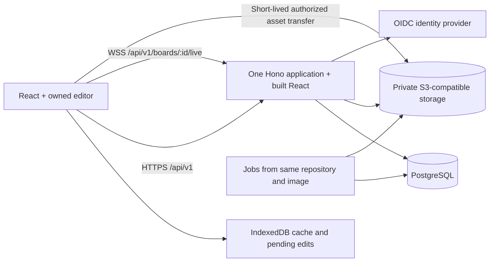

# Hydraw cloud and collaboration plan

Proposed, 26 October 2026. This is a design and implementation sequence, not a
description of shipped functionality. It extends [PLAN.md](../PLAN.md).

Architecture-first update: [EDITOR_ARCHITECTURE.md](EDITOR_ARCHITECTURE.md) defines
the prerequisite redesign and local two-session acceptance gate. Complete it before
implementing cloud identity, persistence or transport. The operation model below
is a proposal to validate at that gate, not a settled protocol.

## Recommendation and assumptions

Keep the instant, account-free local canvas. Add optional cloud boards with
accounts, multiple boards, recovery and sharing; then enable live collaboration
through a server-authoritative operation stream. Keep React, Hono and networking
outside the document rules. Preserve portable native files.

Assume a small team building for individuals and small engineering teams, one
initial region, and an initial live-room target of 10 editors plus 20 viewers.
These are planning targets to test, not established capacity. Provider, budget,
data residency and the need for automatic offline merging remain open decisions.
Hosting must be cost-conscious. No paid provider is selected; choose deployment
only after agreeing a budget and comparing total running and maintenance costs.

The important product choice: the first collaboration release supports responsive
online editing and recoverable disconnected work. It does not promise automatic
merging of independently edited offline copies. If that promise is required,
evaluate a CRDT before building the operation protocol below.

## Product scope

| Stage              | Features                                                                                                                                | Why this belongs here                                      |
| ------------------ | --------------------------------------------------------------------------------------------------------------------------------------- | ---------------------------------------------------------- |
| Cloud foundation   | Sign in, personal board list, create/rename/duplicate/trash/restore, explicit upload of a local board, autosave, open on another device | Establish ownership and trustworthy persistence            |
| Sharing            | Private by default, named viewer/editor invitations, revocation, optional revocable view links, board owner controls                    | Share an architecture diagram without losing control of it |
| Live collaboration | Presence, colored cursors, remote selections, live committed edits, reconnect, conflict feedback, personal undo                         | Work together on the existing diagram workflow             |
| Recovery           | Automatic checkpoints, named versions, preview and restore as a new revision, native download                                           | Protect shared work from mistakes                          |
| Team follow-up     | Shared workspaces, workspace roles, shared reusable library, comments anchored to objects or canvas points                              | Add when team usage warrants it                            |

Defer anonymous editing, character-level collaborative text, enterprise SSO,
billing, AI, public discovery, video/chat, global active-active writes and broad
workflow tooling. View links are bearer access: the sharing dialog must explain
that anyone holding the link can view and copy its content. Public indexing stays
off. Editing requires an authenticated identity in the first release.

Do not make sign-in the landing page. The local canvas remains usable during cloud
outages. Distinguish local boards from account-owned boards visibly. Keep export
available in both. Library upload is a separate explicit action; signing in must
not silently upload the browser's board, images or personal library.

## Local foundation after the architecture refactor

- `@hydraw/document` already owns immutable semantic records, limits, graph
  validation and atomic reversible transactions. Reuse these rules on the server.
- Local transaction builders feed ID-addressed operations with record and
  relationship dependencies. `DocumentSession` owns committed state and personal
  history. It supports incremental external application and explicit commit events.
  This in-process contract still needs authenticated durable network sequencing.
- Gestures preview locally and commit once. External changes preserve unrelated
  interactions and cancel conflicting gestures, retaining conflicting text drafts.
  Cursors and optional drag ghosts remain future ephemeral presence.
- The board repository uses stable board identities, per-board IndexedDB writer
  locks and atomic recovery. The UI still opens the default local board. Cloud
  requires account-scoped caches and an account/board list.
- Portable semantic image records retain embedded PNG sources. A storage codec
  extracts immutable assets into reference manifests and hydrates them on read.
  Cloud transport must use that boundary rather than transmit pixels on movement.
- One Dockerfile already packages Hono and React. Retain that deployment contract.
  The API currently exposes health only; auth, storage and collaboration are new.

## Deployment architecture

Start with one app replica and PostgreSQL in one region, private object storage,
and an established OIDC provider. Keep identity mapping and application sessions
in our backend; choose the provider after budget and hosting constraints are known.
Use a mature OIDC/session implementation rather than building password recovery.
Database access and bucket credentials remain server-side.

Run cleanup, checkpoints and backup verification as durable jobs. Initially a
Postgres jobs table and scheduled worker invocation are sufficient; use the same
image with a different entry point when work needs a separate process. No Redis,
Kafka, Kubernetes or independent collaboration service is needed initially.

Hosting remains undecided. Keep the Docker application, PostgreSQL and asset-store
interfaces portable. Compare existing infrastructure, a self-hosted deployment and
hosted services against an agreed budget before selecting anything. Include compute,
database, storage, backups, bandwidth, identity and maintenance in that comparison.
Develop and validate locally first; no paid service is a prerequisite for the
collaboration prototype. Validate WebSocket support and reconnect behavior on the
eventual host, and design multi-replica rooms without relying on sticky sessions.

Keep deployment configuration in the repository, staging isolated from production,
and local cloud development reproducible with PostgreSQL, an S3-compatible test
store and a test identity provider. Local-only development should still require no
external accounts. Pin new runtime dependencies and extend package-boundary checks.

## Ownership and persistent data

Create a personal workspace per user, with boards owned by that workspace. This
provides a future team boundary without requiring team UI in the first release.
Start with explicit board grants; introduce workspace-wide access with team work.

| Data                         | Responsibility                                                                             |
| ---------------------------- | ------------------------------------------------------------------------------------------ |
| Users, identities, sessions  | Internal user ID, provider subject mapping, revocable sessions                             |
| Workspaces, memberships      | Ownership scope; personal owner initially                                                  |
| Boards                       | Workspace ID, canonical revision, name, schema/protocol version, trash state               |
| Board grants and invitations | Viewer/editor grants; expiring one-time invitations bound to verified identity             |
| Share links                  | Hashed random secret, board, expiry and revocation; view-only initially                    |
| Board state                  | Canonical semantic state encoded with asset references; initially a bounded JSONB snapshot |
| Operations                   | Board revision, operation ID, actor, canonical changes, acceptance result                  |
| Versions                     | Immutable checkpoint manifest, revision, author and optional name                          |
| Assets and references        | Verified media metadata, private object key, board/version references                      |
| Jobs and audit events        | Retryable work; security-relevant sharing, restore and deletion events                     |

Every repository query is scoped by authorized ownership/grants. Board IDs and
object keys are identifiers, never proof of access. Enforce the same permission
policy on snapshots, live joins, edits, assets, history, exports and thumbnails.
Owner manages access and deletion; editor edits; viewer reads. Object `locked`
metadata is a drawing affordance, not an access-control boundary.

Keep cloud metadata out of `.hydraw.json`. Document format version, cloud storage
codec version, wire protocol version and monotonically increasing board revision
are separate contracts. Board name has one authoritative semantic value; any list
projection updates in the same database commit.

## User and save flows

1. **Start locally:** draw immediately and retain today's browser save/recovery.
2. **Save to cloud:** sign in, explicitly choose the local board, upload and verify
   assets, then atomically create the cloud board. Retain the original local copy.
   Use an idempotency key so a retried upload cannot create duplicate boards.
3. **Open a cloud board:** authorize, fetch state and revision, hydrate/cache assets,
   then attach the live stream from that revision. A stream catch-up closes the
   gap between fetching state and joining. Warm caches can render sooner, with
   clear stale/offline state. Never render another account's cache as this account.
4. **Edit:** preview immediately, persist committed work to the local pending queue,
   then submit it. Separate “Saved on this device”, “Syncing”, “Saved to cloud”,
   “Offline” and “Needs attention”. Cloud-saved means database commit acknowledged.
5. **Share:** owner grants a verified user viewer/editor access or creates a view
   link. Joining never changes ownership. Revocation invalidates live access and
   future asset authorization; already downloaded copies cannot be recalled.
6. **Disconnect:** continue a local draft with a clear offline indicator. Reconnect
   fetches accepted changes first, then retries pending operations. Conflicts keep
   the draft and offer retry after review or save as a separate board. Never
   silently replace the shared board with an offline snapshot.
7. **Sign out/account switch:** stop sessions and streams, clear account-scoped
   caches according to the chosen device policy, and preserve/export unsynced work
   before removing its only copy. Do not upload that work into the next account.

Offline cold startup is separate PWA work; today only an already loaded page can
edit offline. Cached cloud content also cannot provide instantaneous offline
revocation. State that limit when defining shared-device cache behavior.

## Collaboration model

### Choose server ordering first, subject to a prototype gate

Use atomic, ID-addressed change batches with expected versions for touched records
and any other records the operation depends on. The server orders accepted edits
per board. Unrelated objects can change concurrently; a stale change to the same
record is rejected with recoverable conflict feedback. This intentionally favors
graph validity and explicit conflict handling over inventing OT or merge rules.

Examples: two users moving different nodes succeed; two users moving the same
node from the same version cannot both succeed. A group move is one atomic batch;
if a required member changed, reject the entire move. Creating a connector validates
its endpoint records; deleting a node removes incident connectors in the same
canonical operation, using the latest locked state. A concurrent connector create
is either included in that deletion or rejected after it, never left dangling.

Use explicit stable IDs for mutations, server-built array positions for the local
transaction adapter, and a versioned scene-order policy with deterministic ID ties.
Reordering checks a scene-order revision; grouping checks its membership read-set.
Do not ship array offsets as object identities or treat `zIndex` alone as a complete
concurrent ordering algorithm. Restoring or replacing a board is a guarded whole-
board operation that invalidates stale pending edits.

Before live release, prototype two real editors against the same board. If
same-record conflicts make ordinary pair diagramming frustrating, revise the model
before rollout: consider geometry deltas or narrowly defined field conflicts, or
choose Yjs if seamless offline merging/shared text is essential. A CRDT is not a
drop-in wrapper around the existing transactions: graph deletion, groups, order,
validation, quotas and local history still need explicit policies. Yjs provides
[origin-scoped undo](https://docs.yjs.dev/api/undo-manager) and a separate
[awareness protocol](https://docs.yjs.dev/api/about-awareness); evaluate them rather
than writing a custom CRDT if those requirements become central.

### Durable operation lifecycle

An envelope carries protocol version, board ID, client session ID, unique operation
ID, last seen board revision, expected record versions and a bounded change batch.
Actor and permissions come from the authenticated session, never the payload.

1. Client persists intent and pending changes in IndexedDB. Maintain confirmed state
   separately from the optimistic projection; dependent pending edits stay ordered.
2. Server starts a short database transaction, locks the board row, rechecks access
   and checks the operation ID. Identical retries return their original result;
   reuse with a different payload is rejected. Bound retry age and deduplication
   retention together so an expired retry cannot be accepted as a new operation.
3. Resolve IDs, verify read/write versions, validate the complete candidate graph,
   asset ownership and quotas. Publish no partial changes on failure.
4. Atomically persist canonical state, next revision, operation/result and required
   audit/reference changes. Acknowledge and broadcast only after commit.
5. Clients apply revisions in order, deduplicate, detect gaps, and fetch catch-up
   or a fresh snapshot when history has been compacted. Lost broadcasts are
   repaired by revision checks; the socket is never the durable source of truth.
6. On rejection or remote updates, rebuild the optimistic projection over confirmed
   state. Pause any dependent edits that no longer apply and preserve their draft.

Postgres row locks can serialize competing board writers across deployment overlap;
see [explicit locking](https://www.postgresql.org/docs/current/explicit-locking.html).
Keep locks short and bound transaction time. An in-memory room queue is only an
optimization. Initially rewriting bounded JSONB state is acceptable only if load
tests pass; move to per-record state or checkpoint-plus-log materialization when
measured write amplification warrants it.

### Presence, gestures, text and undo

Presence is ephemeral, rate-limited and expires after missed heartbeats. Send
world-space cursors, selected IDs and editing indicators; derive identity on the
server. Camera and selection stay local. Optional follow-user mode is explicit.
Drag ghosts are advisory and never enter document storage or undo. Send final
gesture commits reliably; drop intermediate presence under backpressure.

Keep plain-text editing local until commit initially. Show who is editing an
object; simultaneous text commits use the same explicit conflict rule. A remote
change to a gesture's dependency cancels/restarts the gesture with feedback rather
than allowing a stale preview to overwrite it. Presence is not a correctness lock.

Undo targets the current user's accepted action. Submit a fresh inverse operation
only if its affected records still match the versions that action produced;
otherwise show that the action can no longer be undone safely. Never roll back
remote changes or rewind a shared snapshot. Redo follows the same rule. Canceling
unsent work removes it from the pending queue; work in flight must be resolved
before an inverse is submitted. Local-only boards retain existing history behavior.

## Images, exports and retention

Store normalized immutable images in a private S3-compatible bucket. Upload through
short-lived authorization scoped to board, size and type; verify actual bytes,
dimensions and checksum before marking an asset ready. Incomplete uploads are not
referenceable. Avoid arbitrary remote image URLs and server-side URL fetching.

Use a versioned cloud codec mapping embedded image sources to asset IDs, while
hydrating the existing document model at the boundary initially. Geometry updates
must transmit asset IDs rather than PNG strings. Do not put expiring signed URLs
in semantic records. Keep deduplication within an authorization scope and never
expose a global “does this hash exist?” oracle.

Native export resolves authorized assets and embeds them to preserve the current
version-1 file contract. Imports use the existing validator before extracting
assets. Cache authorized pixels for offline drafts; report missing assets clearly.
Clipboard and personal library fragments retain their portable contract.

Retain assets referenced by current boards, retained versions, trash and accepted
undo/retry windows. Use delayed mark-and-sweep cleanup with rechecks to avoid
deleting an asset referenced by a concurrent commit. Unfinished uploads expire.
Thumbnails are private derived artifacts keyed by revision, not public previews.

Propose 30-day trash and automatic-version retention, with named checkpoints kept
until explicitly removed subject to quotas. Finalize limits against budget before
launch. Restore creates a new validated revision and preserves the pre-restore
state; database disaster recovery is a separate procedure.

## Security, operation and scaling gates

- Secure HttpOnly sessions, CSRF protection for cookie-authenticated mutations,
  OIDC state/nonce/PKCE as appropriate, strict live Origin validation, message-level
  authorization and session expiry handling. Follow the
  [OWASP WebSocket guidance](https://cheatsheetseries.owasp.org/cheatsheets/WebSocket_Security_Cheat_Sheet.html).
- Scope every asset transfer; use short-lived signed reads where supported. Their
  expiry bounds revocation delay. Prevent tokens in logs, referrers or analytics.
- Define cloud limits for document bytes, operations, uploads, storage and members;
  native 200 MB import support is not a promise of 200 MB live messages. Start load
  fixtures at 100, 1,000 and current record limits, including image/ink-heavy boards.
- Log request/operation IDs, revision, timing and error codes without document text,
  image bytes or credentials. Measure commit latency, conflict rate, reconnect/gap
  recovery, pending-queue age, database saturation, storage and asset egress.
- Proposed initial targets: local preview p95 below 16 ms on documented hardware,
  same-region durable edit acknowledgement p95 below 250 ms at the room target,
  and reconnect recovery within 5 seconds for a small pending queue. Measure before
  claiming these. Benchmark text layout across clients; do not let server font
  differences independently rewrite semantic bounds.
- CI retains `ready` and Docker checks; add real Postgres/object-store integration,
  multi-client browser journeys and old/new protocol compatibility. Run additive
  schema migrations once per release, with restore/roll-forward procedures.
- Use external uptime checks, readiness for required dependencies, graceful socket
  draining, client backoff/jitter and a cloud-edit kill switch that preserves drafts.
- Enable and verify database backups/PITR and an independent export path; preserve
  matching asset versions. Proposed launch goals are RPO at most 15 minutes and RTO
  at most 4 hours, contingent on a successful restore drill. History is not backup.
  Select and cost the backup approach with the eventual deployment; verify database
  and asset recovery together rather than assuming the host provides it.

Scale only after measuring. Multiple app replicas require cross-instance durable
revision catch-up, authorization invalidation and presence fan-out. Add a broker
such as Redis for notifications when justified, keeping PostgreSQL authoritative
and recovering missed notifications by revision. Test clients on different replicas
and old/new deployments. Later, route hot boards to dedicated room workers if board
lock contention or materialization cost warrants it. Start single-region; choose
regional board ownership before attempting multi-region writes.

## Small implementation milestones

Each row should be split further when it cannot land as one cohesive, verified
commit. Add accepted ADRs when decisions are implemented; this proposal alone does
not change existing document or deployment contracts.

| Order | Milestone                                        | Exit evidence                                                                                                                                                 |
| ----- | ------------------------------------------------ | ------------------------------------------------------------------------------------------------------------------------------------------------------------- |
| 0     | Editor architecture and local collaboration gate | Complete EDITOR_ARCHITECTURE.md: document session, ID operations, external apply, conditional history, stable text geometry and two-session conflict evidence |
| 1     | Assets and multiple local boards                 | Complete the architecture gate's asset/repository seams, per-board storage/locks and recovery; existing local data preserved; no cloud dependency             |
| 2     | Identity, tenancy and database foundation        | Reproducible migrations, sign-in/out, personal workspace; cross-user access and account-cache isolation tests                                                 |
| 3     | Cloud boards and verified assets                 | Explicit upload, board list, revision-conditional saves, asset codec and native round trips; retry/crash tests; no silent concurrent snapshot overwrite       |
| 4     | Sharing and recovery                             | Viewer/editor invitations, view links, revocation, trash, checkpoints/restore; unauthorized HTTP/socket/asset/history tests                                   |
| 5     | Durable operations and collaborative history     | Commit seam, ID/version protocol, optimistic queue, remote apply and personal undo; duplicate/lost acknowledgements, conflicts and compaction tested          |
| 6     | Live rooms and reconnect                         | Presence, ordered stream, catch-up, reconnect and draft recovery; multi-client races and restart/deployment overlap tested                                    |
| 7     | Production release gate                          | Staging/load evidence, restore drill, alerts, spend controls, quotas and rollback/kill-switch exercise                                                        |
| Later | Teams, comments, cloud library, PWA              | Separate proposals justified by usage; explicit migration of local library                                                                                    |

Milestone 3 may use conditional whole-snapshot writes as a temporary private-board
step. Before shared live editing, retire that write path or route it through the
same canonical revision mechanism; old clients must never bypass operation checks.
Do not ship two independent writers for one board.

The architecture-first sequence is implemented locally; see EDITOR_ARCHITECTURE.md
and ADR 0016 for its contract and test coverage. The next implementation stage is
cloud foundation only after reviewing the remaining product constraints, including
budget, offline expectations and conservative same-record conflict behavior.
