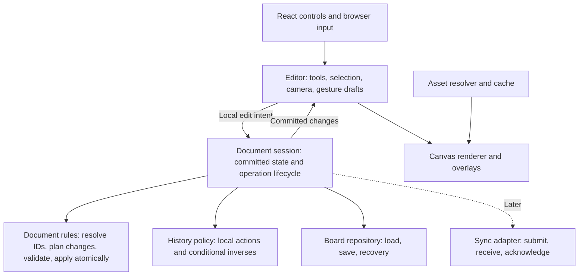

# Editor architecture before cloud implementation

Implemented locally, 26 October 2026. The document/session, external-edit, history,
text-geometry, asset-codec and per-board repository boundaries are in place. Cloud
identity, durable remote sequencing and networking remain later work; no hosting
provider is selected. The product UI still opens one default local board; repository
and session APIs support independent board identities without adding a board-list UI.

## Assessment

The drawing engine is a useful foundation, not a reason for a renderer rewrite.
Document rules are independent of React and Hono, rendering consumes snapshots,
browser input is an adapter, and gestures preview before committing. Preserve
geometry, hit testing, connector routing, Canvas rendering, exports and the existing
interaction behavior.

Before this refactor, state management assumed one local writer. That was fine
for local editing and could support cloud snapshot backup, but is insufficient for
reliable collaborative editing. Address these assumptions before implementing
accounts, remote storage or live transport. This does not establish that current
rendering performance is optimal; measure it independently.

| Starting behavior                                                     | Problem for collaboration                                                 | Implemented change                                                                                   |
| --------------------------------------------------------------------- | ------------------------------------------------------------------------- | ---------------------------------------------------------------------------------------------------- |
| `Editor.commit()` directly executes `TransactionHistory`              | Every edit is implicitly local and history-producing                      | One document session owns committed changes; distinguish local, remote, undo and replacement origins |
| Transactions require array indices and complete before-record matches | Unrelated insertion shifts indices; all fields of one record conflict     | ID-addressed operations with explicit dependencies; compile local transactions against current state |
| `replaceDocument()` clears history, camera and selection              | Import/replacement is the only existing external document path            | Incremental remote application preserves valid local interaction state                               |
| Undo applies a stored inverse to today's document                     | Remote edits can invalidate its preconditions                             | Conditional, author-scoped inverse operations with a visible unavailable outcome                     |
| `prepareDocument()` recalculates text bounds on open                  | Different browser font metrics can change shared geometry without an edit | Loading validates without changing canonical geometry; layout changes are explicit edits             |
| Image `src` contains full embedded PNG data                           | Updating an image record may carry pixels repeatedly                      | Separate immutable asset bytes from document references at a codec boundary                          |
| Board persistence watches a document revision and saves snapshots     | It does not capture edit identity, origin or acknowledgement              | Explicit commit events and a repository/session boundary                                             |
| One global IndexedDB board and writer lock                            | Board switching and multiple independent sessions are unsupported         | Stable board identity, per-board storage and lock ownership                                          |

These are readiness gaps in mutation, history and persistence. React and Canvas
2D do not need replacing to solve them.

## Target responsibilities

- **Document rules:** semantic records, graph invariants, ID-based operation
  resolution, validation and atomic application. No browser measurements, storage,
  React, Hono or network calls. Return a change set and inverse metadata only on
  success. Existing reversible transactions can remain an internal mechanism.
- **Document session:** sole owner of committed state and the local monotonic
  change counter. Accept local intents and externally accepted operations through
  explicit methods. Emit immutable events containing operation ID, origin and
  changed/deleted IDs. A local change counter is not a future server revision.
- **Editor:** coordinates tools and transient interaction. Read committed state
  from the session and layer gesture/text drafts over it. Rendering stays immediate;
  pointer movement must not wait for persistence or network round trips.
- **History:** records local accepted actions through an explicit policy; remote
  application never creates a local undo entry. Session-local history remains the
  initial implementation, with operation identity and dependency checks built in.
- **Repository:** loads and durably saves board data and recovery independently
  of editor UI. An IndexedDB implementation lands first. Keep board replacement
  atomic and preserve storage failures and unreadable data as today.
- **Assets:** resolves immutable references to bytes/display resources. Keep file
  decoding and Canvas image resources in adapters. Native files stay portable.
- **Sync, later:** owns remote revision, confirmed state, durable pending queue,
  acknowledgements and optimistic projection. It uses the same document/session
  boundaries as local mode; it does not become a second document writer.

Put pure document behavior in `packages/document`. Start the framework-independent
session alongside editor core, with a narrow public API; a separate package is
justified only when actual consumers require it. Browser repositories and session
resource lifecycles remain under the web board feature. Extend boundary checks
when introducing dependencies. Avoid empty transport abstractions and cloud SDKs.

## Decisions to prove locally

**Identity and ordering.** Address edits by stable object IDs, independently of
array positions. Arrays may remain serialization/render projections; a lookup map
can be a derived index rather than another authority. Define an explicit scene
order and deterministic ties, with a guarded reorder operation. Preserve the
current visual order through adapters; changing the native format requires an
explicit version/migration decision, not incidental refactoring.

**Atomic graph edits.** Operations declare the objects/relationships they depend
on. Delete-node/incident-connectors, group movement, duplication and reorder must
resolve against current state and validate as one batch. Test create-connector vs
delete-node and group-membership races. Do not infer concurrency safety from
individual record validation.

**Conflict policy.** Prototype the proposed server-ordered, record-version model
with two in-process sessions and a deterministic fake relay. Distinct records
should combine; same-record conflicts should preserve both users' work for review.
Test moving a node while another user changes its label: record-level rejection
may be too coarse for normal use. Choose field dependencies, semantic operations
or a CRDT based on this evidence before treating the protocol as settled. Do not
build custom OT or silently adopt last-writer-wins for whole records.

**Text geometry.** Opening or receiving a document must not measure text and write
new bounds into shared state. A user text/style/width edit proposes explicit bounds
through the injected layout adapter; the rules validate their numeric and semantic
limits without invoking browser fonts. Preserve canonical remote bounds. Define
font availability and layout fallback separately before claiming cross-platform
visual fidelity. Existing local files need an explicit, tested path for any layout
repair; it must not run silently on every session open.

**Interaction reconciliation.** Unrelated accepted changes preserve the camera,
selection and gesture. Changes to a gesture's dependencies cancel/restart its draft
with a recoverable outcome. Deleted objects leave selection; text drafts survive
as recoverable drafts when their target disappears. No entire-editor reset for an
ordinary external edit.

**Asset representation.** First add a codec/resolver seam with an in-memory or
local asset implementation. Test image crop, reflection, clipboard, library,
import/export and missing pixels. Choose between retaining version-1 embedded
records behind a codec or introducing a versioned reference model based on actual
cost and complexity; do not require remote URLs in the core model.

## Implementation sequence and gate

The refactor landed in cohesive commits with focused regressions and repository
checks, keeping the existing application usable throughout.

1. Add a document session with explicit commit events and origin. Route local
   edits/undo through it; preserve all existing editor behavior.
2. Add ID-based operation resolution and dependency metadata. Keep existing
   transaction builders behind an adapter while migrating incrementally.
3. Add incremental external application, interaction reconciliation and conditional
   history. Remove automatic geometry rewriting from document-open paths.
4. Exercise two sessions through an in-memory relay with controlled delay,
   duplicates, reordering and conflicts. Record the chosen concurrency policy in
   an ADR after testing the real drawing workflows.
5. Introduce the asset codec/resolver and board repository boundaries, then
   multiple local boards with per-board locks and existing-data preservation.
6. Run the existing `ready` and Docker checks, plus the new architecture scenarios.
   Profile representative large/image/ink-heavy boards to catch regressions.

The gate is passed when two independent sessions can exchange committed changes,
preserve valid graphs, retain local camera/selection, safely handle conflicting
gestures and personal undo, and open the same document without rewriting its
geometry. Import/export, local persistence/recovery and assets must still work.
The session/rules tests must run without React, Hono, DOM or external services;
browser adapter behavior retains browser tests. Performance evidence must show no
material regression on recorded hardware, rather than claim an unmeasured target.

The two-session tests now cover ID resolution after unrelated deletions, concurrent
proposals, stale conflicts, duplicate and dependent out-of-order delivery, personal
undo, group dependencies, and both connector/deletion race orderings. Editor tests
cover camera/selection preservation, unrelated and conflicting gestures, recovered
text drafts, and unchanged geometry across different font metrics. Browser tests
exercise repository isolation, writer locks, atomic asset/recovery writes and
missing/corrupt image preservation.
See [the verification record](EDITOR_BENCHMARK.md) for suite counts, reproducible
before/after measurements and their limits. Technical local readiness does not
establish production network behavior or validate the conflict UX with real users.

Only after this gate should cloud identity, database persistence, asset uploads
and WebSockets be implemented. The [cloud plan](CLOUD_PLAN.md) describes that later
work. This refactor prepares the necessary boundaries without committing to a
hosting provider or promising automatic offline merging.
